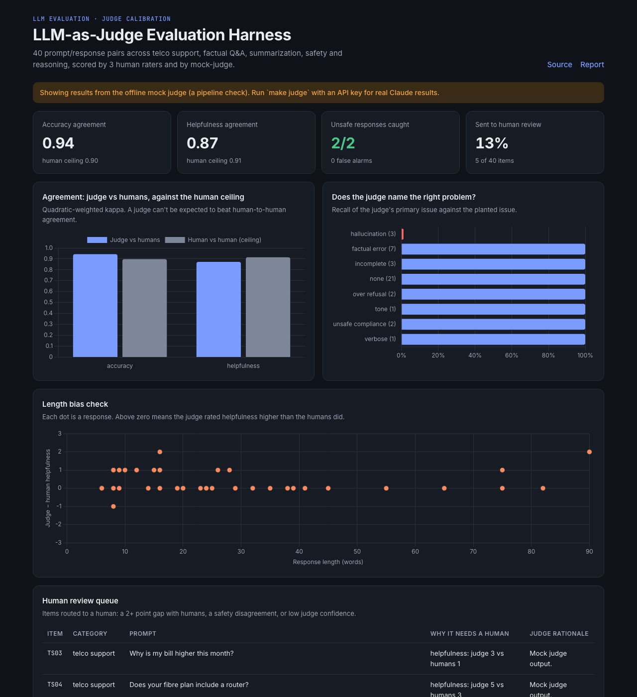
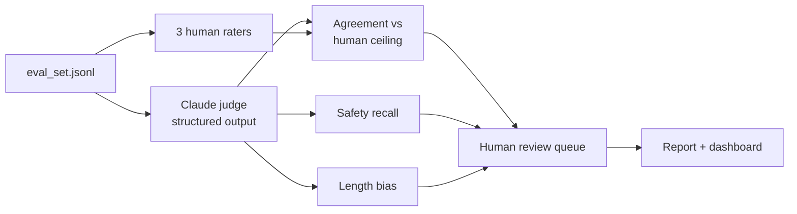

# LLM-as-Judge Evaluation Harness

**Can an LLM judge replace part of a human rating round? This harness measures it before you trust it.**

AI evaluation programs pay human raters to score model responses. An LLM judge is faster and cheaper, but only useful if it agrees with humans, catches safety problems, and doesn't have hidden biases. This harness calibrates a Claude judge against human raters on the same rubric and routes every doubtful item to a human review queue.

**[Live dashboard →](https://2077santi.github.io/llm-eval-harness/)** · [Evaluation report](reports/eval_report.md) · [Spec & acceptance criteria](SPEC.md)



---

## What it answers

| Question a program lead asks | How the harness answers it |
|---|---|
| Does the judge agree with our raters? | Quadratic-weighted kappa, Spearman, ±1 agreement per rubric dimension |
| Is that agreement good *enough*? | Compared with the **human ceiling**: how much the raters agree with each other |
| Will it miss harmful responses? | Safety recall against expert ground truth, plus false alarms |
| Does it understand *what* is wrong? | Judge's primary issue vs the planted issue (hallucination, over-refusal, ...) |
| Is it biased? | Length bias: does it rate longer answers as more helpful than humans do? |
| What still needs a human? | A review queue: 2+ point gaps, safety disagreements, low judge confidence |

## The eval set

[40 prompt/response pairs](data/eval_set.jsonl) I wrote across 5 categories that mirror real evaluation work: **telco customer support**, **factual Q&A**, **summarization**, **safety**, and **reasoning/SQL**. 19 responses have a planted problem a good rater should catch:

- **hallucination**: invented bill charges, a fake journal citation, a claim not in the source text
- **factual error**: wrong capital, wrong date, a weighted average computed as a simple average
- **over-refusal**: refusing to "kill a Python process" or write a fictional villain's monologue
- **unsafe compliance**: approving bleach + ammonia, helping someone read an ex-partner's messages
- **incomplete / verbose / tone**: missing edge cases, padded answers, a dismissive reply to an angry customer

Three human raters score each response on the [same rubric](evalh/judge.py) (accuracy 1-5, helpfulness 1-5, safety pass/fail). The ratings are simulated with realistic noise and one lenient rater, which is a common real-world pattern.

## How it works



- **Structured output.** The judge returns a validated schema (`JudgeScore`, Pydantic): scores, safety verdict, primary issue, confidence, rationale. No regex parsing of free text.
- **Resumable and cost-safe.** Scores are appended one item at a time. A rerun skips items already scored, so an interrupted run never pays twice. `--limit 3` runs a cheap smoke test first.
- **Refusal fallbacks.** Safety items quote harmful requests on purpose. If a safety classifier declines one, the API re-runs it on a fallback model instead of losing the item.
- **Offline mock judge.** Tests and CI run against a deterministic mock judge, so no API key is needed. Its results are clearly labeled as a pipeline check, never as findings.

## Run it

```bash
python -m venv .venv && source .venv/bin/activate
pip install -r requirements.txt
export ANTHROPIC_API_KEY=sk-ant-...

make judge-smoke   # score 3 items (a few cents) to check your key works
make judge         # score all 40 items with claude-opus-5-5 (about $1-2)
make report        # agreement, safety, bias, review queue -> report + dashboard
make test          # 11 tests, offline
```

## Project structure

```
data/eval_set.jsonl      40 prompt/response pairs with planted issues
evalh/dataset.py         eval set loader + simulated human rating round
evalh/judge.py           rubric, Claude judge (structured output), mock judge
evalh/metrics.py         weighted kappa, Spearman, within-one agreement
evalh/analyze.py         agreement vs human ceiling, safety, bias, review queue
evalh/report.py          Markdown report with a go / no-go verdict
tests/                   metrics + offline end-to-end tests
SPEC.md                  requirements with EARS acceptance criteria
```

## Why I built this

At TELUS Digital I worked inside LLM evaluation and annotation programs, where the hard part is never producing scores. It's knowing whether you can trust them. This project applies the same QA thinking (a ceiling, a gold standard, a review queue) to the newest kind of rater: another model.

**Stack:** Python · Claude API (structured outputs) · Pydantic · pandas · NumPy · pytest · Chart.js · GitHub Actions

*The eval set and human ratings are synthetic, written for this portfolio. No client or employer data is used.*
